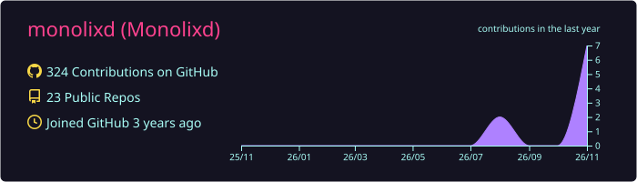
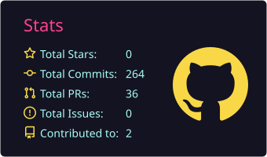
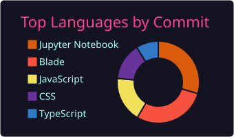
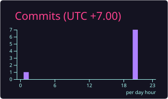
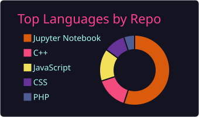

<!-- ═══════════════ HEADER ═══════════════ -->
<p align="center">
  
</p>

<p align="center">
  <a href="https://git.io/typing-svg">
    
  </a>
</p>

<p align="center">
  
  <a href="https://github.com/monolixd?tab=followers"></a>
  <a href="https://github.com/monolixd?tab=repositories"></a>
</p>

<!-- ═══════════════ ABOUT ═══════════════ -->
<h2>
  
</h2>

<table>
<tr>
<td width="55%" valign="top">

```javascript
const monolixd = {
  role:      ["🤖 AI Developer", "🎓 Founder @ Plearn Academy"],
  mission:   "🌎 Make this world better with code",
  education: "👨‍💻 Information Technology Major",
  interests: ["Artificial Intelligence", "Machine Learning", "Web Development"],
  learning:  ["Deep Learning", "Neural Networks", "Computer Vision"],
  funFact:   "I dream in code and debug in my sleep! 💤🐛",
  status:    () => "Always shipping 🚀",
};
```

</td>
<td width="45%" align="center">
  
</td>
</tr>
</table>

<!-- ═══════════════ TECH STACK ═══════════════ -->
<h2>
  
</h2>

<div align="center">

### 💾 Languages


### 🧩 Frameworks & Libraries


### 🧠 AI & Data Science


### 🎨 Design & Creative


### 🛠️ Tools & Hardware


</div>

<!-- ═══════════════ STATS ═══════════════ -->
<h2>
  
</h2>

<div align="center">
  
  <br/>
  
  
  <br/>
  
</div>

<!-- ═══════════════ CODING HABITS ═══════════════ -->
<h2>
  
</h2>

<div align="center">
  
  
</div>

<!-- ═══════════════ SNAKE ═══════════════ -->
<h2>
  
</h2>

<div align="center">
  <picture>
    <source media="(prefers-color-scheme: dark)" srcset="https://raw.githubusercontent.com/monolixd/monolixd/output/github-snake-dark.svg" />
    <source media="(prefers-color-scheme: light)" srcset="https://raw.githubusercontent.com/monolixd/monolixd/output/github-snake.svg" />
    
  </picture>
</div>

<!-- ═══════════════ QUOTE ═══════════════ -->
<h2>
  
</h2>

<div align="center">
  
</div>

<!-- ═══════════════ CONNECT ═══════════════ -->
<h2>
  
</h2>

<div align="center">

[](mailto:jakkridjantung@gmail.com)
[](https://linkedin.com/in/your-linkedin)
[](https://github.com/monolixd)
[](https://twitter.com/your-twitter)

</div>

<!-- ═══════════════ FOOTER ═══════════════ -->
<div align="center">
  
  <br/>
  
</div>

<p align="center">
  
</p>
